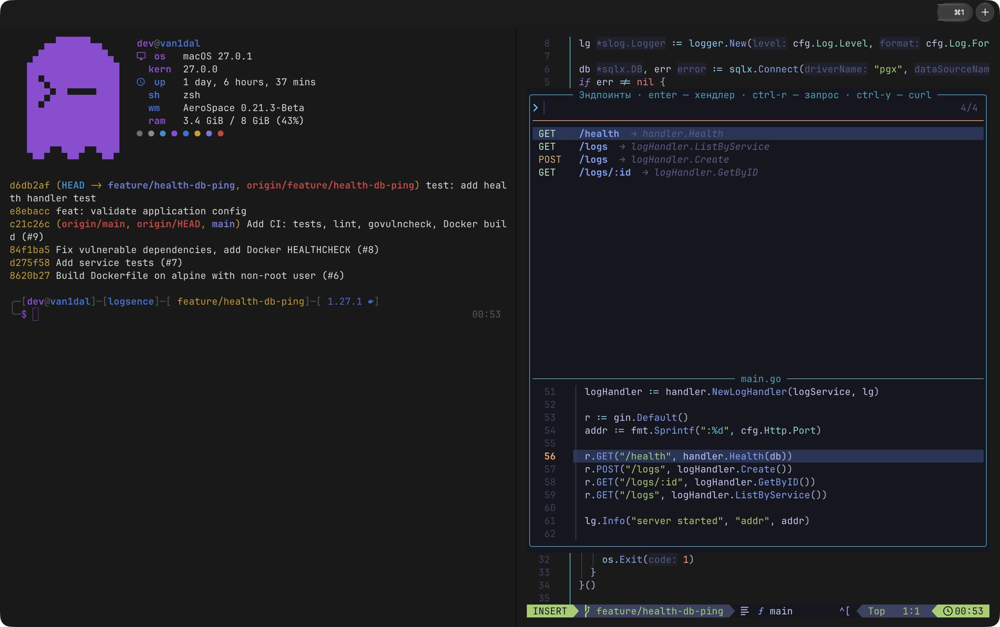
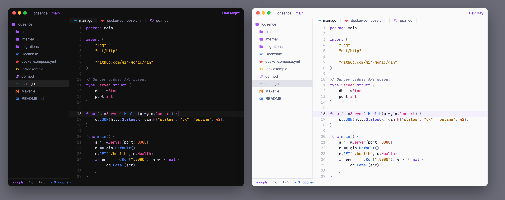
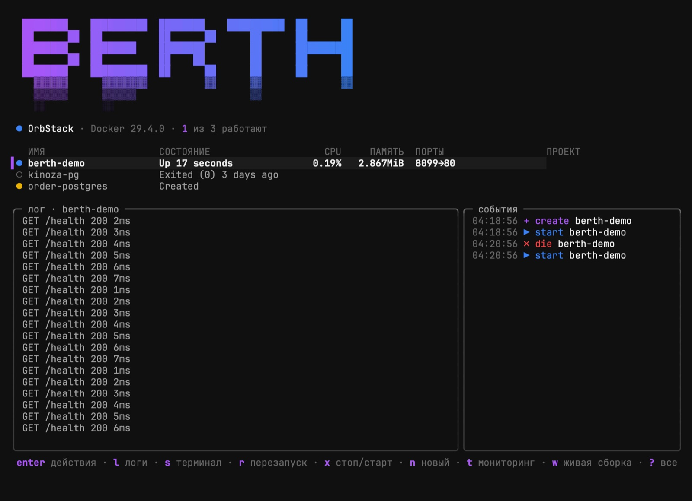
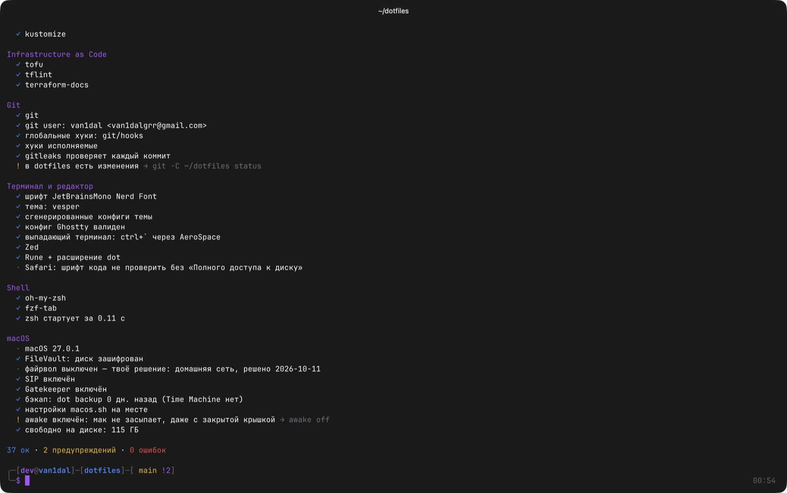
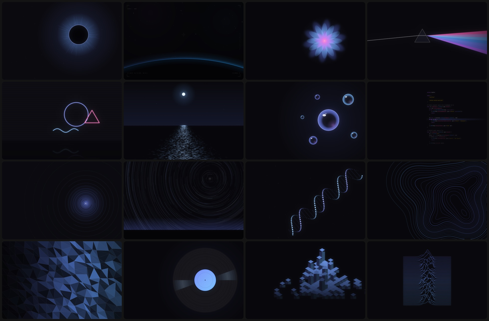
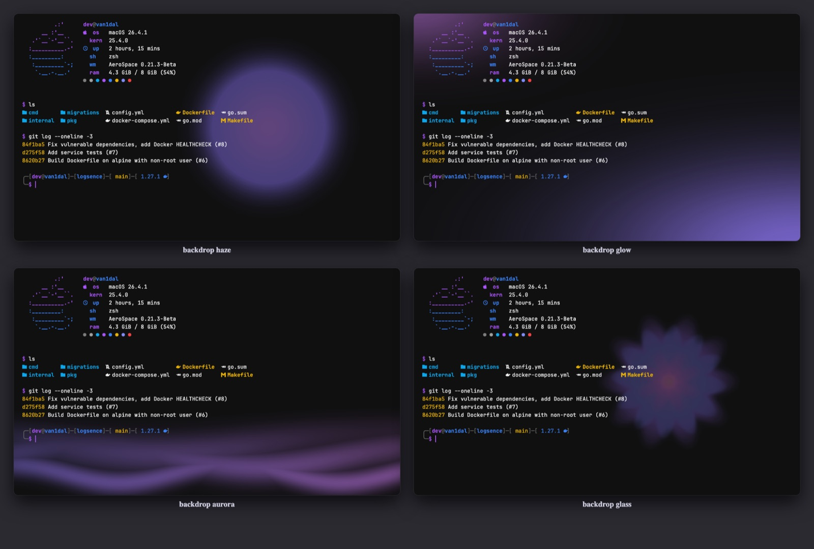

<div align="center">

# dotfiles

My macOS setup for Go and Docker work: dark, fast, and easy on memory.<br>
MacBook Air M2 · 8 GB · zsh · Ghostty · AeroSpace · Zed

[](https://github.com/van1dalgrr-arch/dotfiles/actions/workflows/ci.yml)
[](https://github.com/van1dalgrr-arch/dotfiles/releases)


[](LICENSE)



<sub>Ghostty + Zed tiled by AeroSpace. The terminal's glow is built from the wallpaper's colors. Rendered from real command output.</sub>

**[Install](#install)** · **[What's inside](#whats-inside)** · **[Daily commands](#daily-commands)** · **[Containers](#containers-orbstack)** · **[Health checks](#health-checks)** · **[Customize](#customize)** · **[Docs](#docs)**

🇷🇺 [Русская версия](README.ru.md)

</div>

---

## Why

I have 8 GB of RAM and still run Docker, Go and a couple of editors at the same time. So everything
here is built around two goals: **nothing should lag**, and **it should look good**.

- **Docker runs on OrbStack**, not Docker Desktop. Memory is taken when needed and given back, instead of a VM sitting on 4 GB all day.
- **The prompt is plain zsh**, no starship. Outside a git repo it spawns zero processes; inside, a single `git status`. The shell starts in ~0.15 s.
- **Zed instead of VS Code** for everyday code — usually a fraction of the memory.
- **Wallpapers don't run in the background** — they're regular dynamic HEIC files, macOS switches the frames itself.
- **Everything is checked, not assumed.** `dot doctor` verifies the whole setup in ~2 s and prints the fix for every problem.

> Comments in the configs and messages printed by the commands are in Russian — that's my native language.

## Install

**Requirements:** macOS on Apple Silicon (built on Tahoe; paths assume `/opt/homebrew`), an admin account, internet.

```bash
curl -fsSL https://raw.githubusercontent.com/van1dalgrr-arch/dotfiles/main/bootstrap.sh | bash
```

It installs the Command Line Tools and Homebrew, clones this repo to `~/dotfiles` and runs `make install`.
Anything already there is skipped, so it's safe to run again. `bootstrap.sh --dry-run` shows the plan.

Then:

```bash
exec zsh                 # new shell with everything loaded
./macos.sh               # preview system settings → ./macos.sh --yes to apply
dot doctor               # everything should be ✓
```

<details>
<summary><b>By hand, and what <code>install.sh</code> does</b></summary>

`xcode-select --install` → [Homebrew](https://brew.sh) → `git clone … ~/dotfiles` → `make install`.

`./install.sh` is safe to run again. It:

- symlinks every config (a file already in place is kept as `*.bak`, nothing gets deleted)
- clones oh-my-zsh and fzf-tab at **pinned commits**, without the oh-my-zsh installer, which would overwrite `.zshrc`
- installs Go tools at **pinned versions** from `go/tools.txt`
- builds `orbstack` from `berth/` into `~/go/bin`
- applies the theme and wallpaper

It doesn't install apps (that's `brew bundle`), and it doesn't touch macOS settings (that's `macos.sh`).
Optional extras: `make devops` (Kubernetes / IaC tools) and `./macos.sh` (system settings).

</details>

**Uninstall:** `./uninstall.sh` prints the plan. `./uninstall.sh --yes` removes the symlinks and restores
your `*.bak` files, and `--purge` also deletes the generated theme files. Homebrew packages are left alone.

### Using it yourself

Fork it rather than installing mine as is. Before `make install`:

1. **Git identity:** change `name` and `email` in [`git/.gitconfig`](git/.gitconfig) — otherwise your commits are signed with mine.
2. **Apps:** trim the [`Brewfile`](Brewfile) to what you use (`dot doctor --deep` later lists anything installed outside it).
3. **macOS settings:** read [`macos.sh`](macos.sh) — every setting is one line with a description; run a single group with `./macos.sh --yes <group>`.

## What's inside

| | |
|---|---|
| **Terminal** | [Ghostty](https://ghostty.org) with a transparent title bar, a smooth gliding cursor, and a drop-down window on `` ctrl+` `` from any app |
| **Windows** | [AeroSpace](https://github.com/nikitabobko/AeroSpace) — i3-style tiling; hotkeys work on any keyboard layout |
| **Prompt** | custom zsh in a frame: `╭─[user@host]─[path]─[git]─[Go · compose · ⎈ k8s context]`, command duration, collapses after Enter |
| **Editor** | [Zed](https://zed.dev) with my own themes, Dev Night (dark) and Dev Day (light), that follow macOS, plus icons. Delve, golangci-lint, tasks on `ctrl-r` |
| **GoLand** | the same Dev Night / Dev Day themes as a JetBrains plugin and `.icls` — see [jetbrains/](jetbrains) |
| **Themes** | `theme vesper` / `kanagawa` / `rose-pine`: recolors the terminal, CLI tools, app icons and wallpaper from one palette file |
| **Wallpapers** | `wall`: 33 live wallpapers drawn in Swift that change through the day, plus your own photos, upscaled without blur |
| **Terminal look** | `fx` — Ghostty shaders (cursor, trail, sparks, focus flash, glow) · `backdrop` — the wallpaper's light behind the text |
| **Browser** | Safari — the lightest on 8 GB. Settings in `macos.sh safari`, uBlock Origin Lite from the App Store via the Brewfile, JetBrains Mono for code on every site |
| **Git** | delta for diffs, lazygit, gitleaks before every commit in every repo |
| **Containers** | [OrbStack](https://orbstack.dev), started on demand by any `docker` command, and [`orbstack`](#containers-orbstack) — a live dashboard in Go; `up` runs dependencies + the app in one command |
| **API & DB** | [Yaak](https://yaak.app) instead of Postman, [TablePlus](https://tableplus.com) for databases, `pgcli` via `db` |

<p align="center"></p>
<p align="center"><sub>Dev Night and Dev Day, rendered from the theme file by <code>zed/tools/preview.py</code></sub></p>

## Daily commands

Forgot a command? Press `?` (or `ctrl+/`) — a cheatsheet with every hotkey, function and alias pops up.

| Command | What it does |
|---|---|
| `p` | jump to a project in `~/dev` (fzf with a preview and recent commits) |
| `up` | start only the dependencies from compose (postgres, redis…) and run the app with `.env` |
| `pl` | all projects at once: stack, branch, uncommitted changes, last commit age |
| `gonew myapi` | new Gin project with air and git |
| `got` / `gotw` | run tests with gotestsum / rerun them on every save |
| `pd` | `dot project doctor`: what the current project has and what it's missing |
| `db` | pgcli into the project database (from `DATABASE_URL` / `.env`) |
| `vuln` | vulnerabilities: govulncheck for Go deps + trivy for the rest |
| `load` | load test an endpoint with oha (`/health` by default) |
| `orbstack` | containers: live dashboard, templates, logs, inspect, live rebuild ([more](#containers-orbstack)) |
| `dsh` / `dlogs` | shell into a container / follow its logs (picked with fzf) |
| `gco` | switch branches with fzf |
| `killport 8080` | free a port (TERM first, KILL after 2 s) |
| `ram` | what's eating memory — grouped by app, not by process |
| `lean` | memory report for 8 GB · `lean on` quits heavy apps from a list · `lean off` brings them back |
| `awake on` / `off` | keep the Mac awake with the lid closed (for Claude Code from the phone); `dot doctor` reminds you if it's left on |
| `update` | weekly maintenance: brew, pinned Go tools, Docker junk, tldr, icons, rebuilds `orbstack` |
| `work kinoza-back` / `work off` | project mode: OrbStack, its containers and Zed in one command, `◆ name 1h12m` in the prompt; `off` shuts everything down ([`work/`](work)) |
| `dot sync` | pull fresh dotfiles safely: fast-forward only, never touches uncommitted changes |
| `dot snapshot` | snapshot before a macOS upgrade; `dot snapshot diff` after shows what reset ([checklist](docs/macos-upgrade.md)) |

Type a command that doesn't exist and the prompt tells you if it's available in brew — like `pkgfile` on Arch.

## Containers: `orbstack`



<sub>The dashboard, rendered from its own view with live data from a demo container.</sub>

```bash
orbstack                 # live dashboard
orbstack run postgres    # start from a template — shows the docker run command first, editable
orbstack watch           # live rebuild: save code → image rebuilt, container restarted
```

One screen instead of a dozen commands: containers with CPU and memory refreshing in the table, the selected
container's log and an event feed (start, stop, crash, out of memory). Everything is on a key — `l` logs, `s` shell,
`r` restart, `x` stop/start, `d` remove, `i` a readable inspect with secrets hidden, `f` the Dockerfile (found through
the compose labels), `c` the compose file, `n` new from a template, `w` live rebuild. `enter` lists the actions,
**each explained with the docker command behind it** — so it teaches docker while you use it.

Written in Go with [Bubble Tea](https://github.com/charmbracelet/bubbletea) ([`berth/`](berth)), built by `install.sh`,
tested in CI. It talks to the docker CLI, so it follows any context: OrbStack, Colima, Docker Desktop.
And OrbStack itself needs no babysitting: any `docker` command starts it when it's off. More:
[containers from the terminal](docs/docker.md) · [keys](docs/hotkeys.md#orbstack--containers).

## GitHub: `github`

```bash
github                   # dashboard: CI across repos, PRs, issues, Actions with logs, event feed
github pr merge 42       # the same as commands for scripts
github telegram TOKEN    # notifications on the phone
```

The same kind of screen as `orbstack`, but for GitHub: pull requests with CI status, merge and comments,
issues, Actions runs with highlighted logs (jumps straight to the error), rerun, and an event feed.
Notifications go to Telegram from GitHub Actions every 5 minutes — no laptop needs to stay on.

It lives in its own repo, [github-watcher](https://github.com/van1dalgrr-arch/github-watcher), and is installed
as `gw` from `go/tools.txt`; `.zshrc` aliases `github` to it. **Its code was written by an AI (Claude)**;
the Telegram bot with commands is the part we write together.

## Health checks

### `dot doctor`

```bash
dot doctor           # ~2 s: the whole setup
dot doctor --deep    # ~45 s: + versions, pinned revisions, packages outside the Brewfile, brew doctor, macOS updates…
```

| Section | Checks |
|---|---|
| Install | every symlink, Brewfile and App Store apps, pinned Go tools |
| Tools | Docker, Kubernetes, IaC, git identity and hooks, gitleaks |
| Terminal & editors | font, theme files, Ghostty config, drop-down terminal, Zed, Safari style sheet |
| Shell | oh-my-zsh, fzf-tab, startup time (best of three runs) |
| macOS | FileVault, firewall, SIP, Gatekeeper, Time Machine, free disk, **settings from `macos.sh` that an upgrade reset**, `awake` left on |

It only reads, never changes anything. `✓` ok · `!` worth a look · `✗` broken · `○` optional and not installed.
Every problem line ends with the command that fixes it. Exit codes: `0` ok (warnings allowed), `1` errors, `2` bad usage.

<p align="center"></p>

### `dot project doctor`

```bash
cd ~/dev/myapi && dot project doctor     # or: pd, or: dot project doctor ~/dev/myapi
```

It finds the nearest `go.mod` (from any subfolder) and runs a checklist:

| Group | Checks |
|---|---|
| Go | `go.mod`, module, `go` / `toolchain` version vs the installed Go, `go.sum`, entry point |
| Tests | `*_test.go` count, gotestsum |
| Quality | golangci-lint (+ config), govulncheck |
| Build & run | Makefile targets, Dockerfile (+ `.dockerignore`, multi-stage), compose file, `.air.toml` |
| Database | migrations folder and `.sql` count, sqlc |
| Config & secrets | `.env.example`, **`.env` tracked or not ignored → ✗** |
| Git | branch, remote, uncommitted changes, `.gitignore`, CI |

Missing optional files show up as `○`, not as errors. It never runs migrations, starts containers, or touches the project.

## Customize

### Themes

```bash
theme              # pick with a preview
theme kanagawa     # apply directly
```

One palette file (`themes/<name>.sh`, 19 colors) recolors Ghostty, the prompt, fzf, bat, delta, btop, eza, lazygit,
starship, app and folder icons, and the wallpaper. Light mode (Dev Day) follows macOS. New theme: copy a palette, change the colors, `theme <name>`.
All of them side by side: [docs/themes.md](docs/themes.md).

### Wallpapers



```bash
wall                                      # list with an image preview, enter to apply
wall eclipse                              # apply directly
wall add ~/Downloads/photo.jpg sakura     # your own photo
```

Atmosphere — `mistcity` `hanami` `snowfall` `cosmea` `steppe`<br>
Space — `eclipse` `orbit` `rings` `aurora` `horizon` `startrails`<br>
Tech — `code` `circuit` `ridges` `minimal` `halftone` `iso` `helix` `topo`<br>
Everything else — `petals` `prism` `ocean` `glass` `crystal` `vinyl` `neon` `rain` `bauhaus` `mesh` `kanagawa`

**[See all 30 in the gallery →](docs/wallpapers.md)**

Each wallpaper is a short Swift script in `icons/` that renders 12 frames per day; every parameter is computed
continuously from the hour, so macOS blends smoothly between frames. Photos are cleaned of JPEG artifacts, upscaled
in two Lanczos steps and sharpened (`icons/photo-wallpaper.swift`); they stay in the git-ignored `wallpapers/photos/`.

<details>
<summary><b>Write your own wallpaper</b></summary>

Create `icons/wallpaper-<name>.swift`:

```swift
runWallpaper { hour in
    let ctx = canvas()                     // near-black canvas
    let (a, b) = tint(hour)                // colors for this time of day
    radialGlow(ctx, CGPoint(x: W / 2, y: H / 2), 400 * S, a, 0.3)
    return bloom(ctx.makeImage()!)
}
```

The palette, stars, glow and HEIC builder live in `icons/wallpaper-kit.swift`. Then run `wall <name>`.

</details>

### Terminal backdrop and effects

```bash
backdrop          # pick a style with a preview · backdrop off — no background
fx                # toggle Ghostty shaders: cursor, trail, sparks, focus, glow
```



The backdrop is made from your **current wallpaper**: only its colored light is kept and the dark parts become
transparent, so it works on the dark theme and on light Dev Day alike. `wall` rebuilds it for the new wallpaper,
and Ghostty reloads by itself. Shaders take their colors from the terminal theme.

### macOS settings

```bash
./macos.sh                     # the plan: setting, current value → new value. Changes nothing
./macos.sh --yes               # apply everything
./macos.sh --yes finder dock   # only some groups
```

| Group | Settings |
|---|---|
| `keyboard` | fast key repeat, no autocorrect, straight quotes, no smart dashes |
| `trackpad` | tap to click |
| `finder` | extensions, hidden files, path and status bar, list view, folders first, search the current folder, no `.DS_Store` on network/USB |
| `saving` | to disk rather than iCloud, expanded dialogs |
| `screenshots` | PNG in `~/Pictures/Screenshots`, no shadow, no thumbnail |
| `dock` | autohide, no recents, Spaces stay in place for AeroSpace |
| `appearance` | dark, `ctrl-cmd` drag windows from anywhere |
| `apps` | code files open in Zed (macOS asks to confirm each type — run it at the Mac) |
| `login` | Raycast at login (AeroSpace starts itself and Ghostty) |
| `security` | firewall on, stealth mode (asks for sudo) |
| `safari` | full address, link status bar, Develop menu, no preloading, downloads don't open themselves (needs Full Disk Access for the terminal) |

Running it twice is safe: values that already match are skipped. It restarts only Finder, Dock or SystemUIServer and
never logs you out. `dot doctor` notices when a macOS upgrade puts a setting back.

## Maintain

```bash
update               # brew upgrade, pinned Go tools, Docker junk, tldr, icons, rebuilds orbstack
dot doctor --deep    # anything installed outside the Brewfile? anything outdated?
```

Change a config: edit it in `~/dotfiles` — it's symlinked, so the change is live and shows up in `git status`.
Add a tool: put it in the `Brewfile`, then `brew bundle`.

### Versions

| What | How it's pinned |
|---|---|
| Homebrew packages | `Brewfile` — Homebrew ships only the latest version, so these are the newest at install time |
| App Store apps | `mas "…", id: …` lines in the `Brewfile` |
| Go itself | `brew "go"` globally; **per project, `go.mod` decides** (`toolchain go1.N.x` downloads that exact toolchain) |
| Go tools | `go/tools.txt`: exact versions; `dot tools` shows the status, `dot tools install` applies it |
| oh-my-zsh, fzf-tab | commit hashes at the top of `install.sh` |

**Why not mise / asdf?** For a Go-only setup they'd duplicate what Go already does (the toolchain in `go.mod`) and
add a shell hook. If you install mise for other languages, `.zshrc` activates it automatically, and
`dot doctor --deep` warns when mise manages Go too.

### DevOps toolchain

| | Tools |
|---|---|
| Always (`Brewfile`) | kubectl, helm, k9s, kubectx/kubens, stern, OrbStack (Docker + Compose + buildx), lazydocker, dive, hadolint, trivy, act |
| Optional (`make devops`) | kind, kustomize, opentofu (`tf`), terraform-docs, tflint (built from source at a pinned version) |

All are small arm64 binaries that don't run in the background. Nothing creates clusters or cloud resources on its
own: `kind create cluster` and `tf apply` are always up to you.

## Security

- **Leak protection.** Before **every** commit in any repo, [gitleaks](https://github.com/gitleaks/gitleaks) scans
  what's being committed; a password, token or key blocks the commit and shows the file and line. Per-project hooks
  still run after it (`git/hooks/_chain`). False positive: a `gitleaks:allow` comment on the line.
- **Global `.gitignore`** keeps `.env`, keys and `.DS_Store` out of every repo.
- **Private photos stay private:** `wallpapers/photos/` is git-ignored and backed up to a separate private repo.
- **System:** `dot doctor` checks FileVault, SIP, Gatekeeper, the firewall and backups.

## Development

```bash
make check    # what CI runs: shellcheck, bash 3.2 / zsh syntax, Brewfile, JSON themes, Python, Ghostty shaders, berth (go vet + tests), gitleaks
make test     # smoke tests for dot + install/uninstall in a temp HOME (tests/)
```

Scripts target the system **bash 3.2**, so they work on a clean Mac before Homebrew. CI runs on every push, and a
`pre-push` hook runs the same checks locally. Changes are recorded in the [changelog](CHANGELOG.md).

## Layout

Every folder has its own `README.md` (English) and `README.ru.md` (Russian): what's inside, where it's linked, how to change it.

```
dotfiles/
├── bin/dot          entry point: doctor, project doctor, tools, snapshot, install, update
├── lib/             dot modules: ui, doctor, project, tools, snapshot (bash 3.2, no dependencies)
├── zsh/             .zshrc, prompt, theme loader, cheatsheet, ram, update, gonew, backend
├── themes/          palettes and apply.sh
├── icons/           wallpapers, backdrop, app and folder icons (Swift)
├── ghostty/  aerospace/  zed/  vscode/  jetbrains/  fastfetch/
├── safari/          style sheet for Safari: JetBrains Mono for code
├── berth/           the orbstack command: container dashboard in Go (built by install.sh)
├── git/             .gitconfig, delta, gitleaks hooks, global ignore
├── go/              tools.txt / tools.devops.txt: pinned Go tools
├── tests/          smoke tests for dot, install/uninstall tests (make test, CI)
├── btop/ bat/ eza/ lazygit/ atuin/ tealdeer/ starship/ pgcli/
├── Brewfile         required apps, CLIs and App Store apps   ·  Brewfile.devops: optional
├── bootstrap.sh     clean Mac → everything, one curl command
├── install.sh       symlinks, pinned clones and Go tools, theme   ·  uninstall.sh
└── macos.sh         system settings (prints a plan, applies only with --yes)
```

How it fits together: `brew bundle` installs programs. `install.sh` links the configs from here into `~` and
`~/.config`. `themes/apply.sh` generates the colored copies. `dot` checks all of it.

## Docs

Every document is in English and Russian — [all docs](docs/README.md) · [вся документация](docs/README.ru.md).

| | |
|---|---|
| [How to use it](docs/guide.md) | every command and feature, day to day |
| [Hotkeys](docs/hotkeys.md) | AeroSpace, Ghostty, `orbstack` and Zed |
| [Containers from the terminal](docs/docker.md) | images, containers, volumes; `docker run` flags explained; compose; live rebuild |
| [How it works](docs/how-it-works.md) | architecture, diagrams, the "why" behind every piece, and recipes |
| [Themes](docs/themes.md) · [Wallpapers](docs/wallpapers.md) | all themes side by side · the gallery of 33 live wallpapers |
| [Troubleshooting](docs/troubleshooting.md) | common problems by area, `orbstack` included |
| [Upgrading macOS](docs/macos-upgrade.md) | before/after checklist with `dot snapshot` |
| [If the Mac was wiped](docs/recovery.md) | restore checklist: what comes back by itself, what doesn't |
| [Changelog](CHANGELOG.md) | what changed between releases |

## Thanks

[Vesper](https://github.com/raunofreiberg/vesper) ·
[Rosé Pine](https://rosepinetheme.com) ·
[Kanagawa](https://github.com/rebelot/kanagawa.nvim) ·
[Nerd Fonts](https://www.nerdfonts.com) ·
[Ghostty](https://ghostty.org) ·
[AeroSpace](https://github.com/nikitabobko/AeroSpace) ·
[OrbStack](https://orbstack.dev) ·
[Charm](https://charm.sh) (Bubble Tea, Lip Gloss)

## License

[MIT](LICENSE) — take whatever you like, copy it, make it yours.
