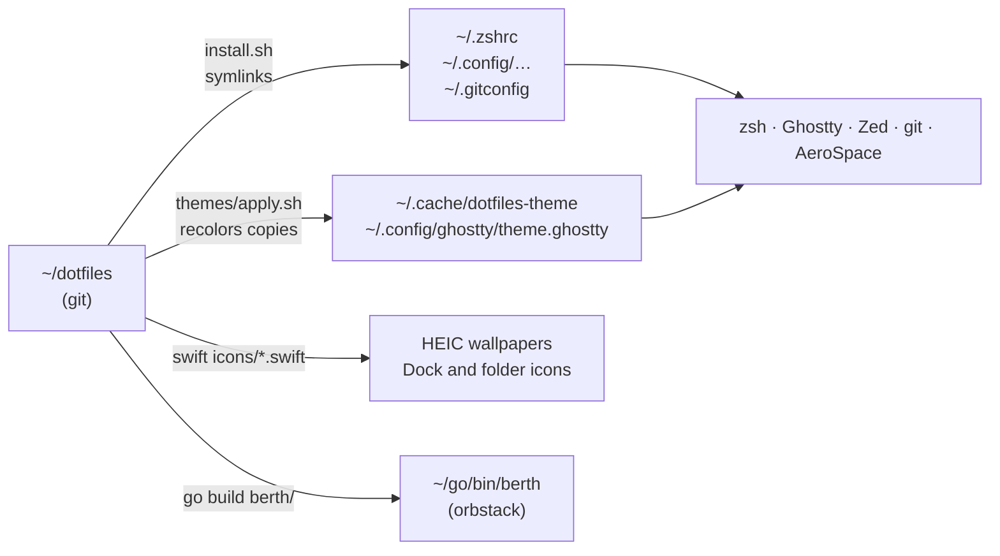
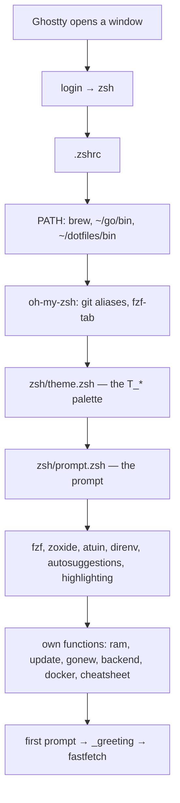
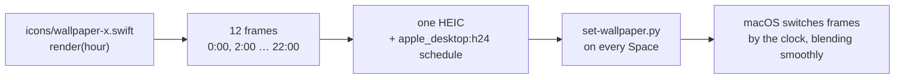
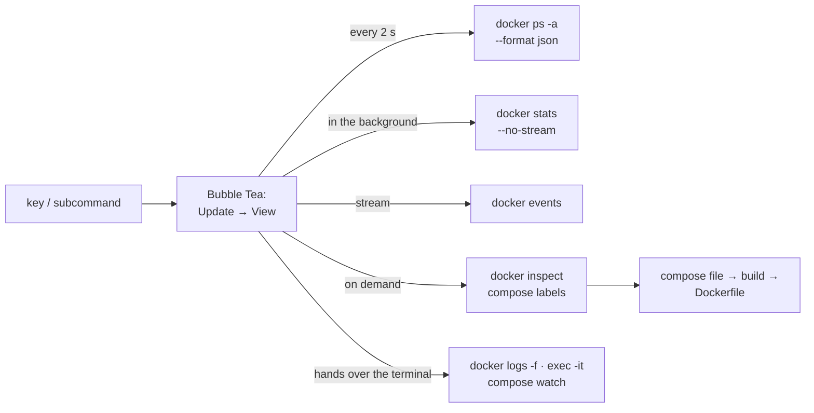

# How it works

🇷🇺 [Русская версия](how-it-works.ru.md) · [all docs](README.md)

> How to **use** it (every command by area) is in [guide.md](guide.md). This one is about how it's **built**.

A document for myself: what lives where, how one piece hooks into another, and **why it's done this way**.
If something broke or you want to change something, start here, then run `dot doctor`.

---

## 1. The big picture

The repo is the source. The system reads configs from their usual places (`~/.zshrc`, `~/.config/…`),
and those are **symlinks** to files in `~/dotfiles`. Edit a file in the repo and the change is live
in the system right away, and shows up in `git status`.



Three kinds of files:

| What | Where | Edit by hand? |
|---|---|---|
| sources | `~/dotfiles/**` | yes — these *are* the settings |
| symlinks | `~/.zshrc`, `~/.config/zed/settings.json`, … | no point — they point into the repo |
| generated by the theme | `~/.cache/dotfiles-theme/*`, `~/.config/ghostty/theme.ghostty` | no — `theme` overwrites them |

## 2. Install: `install.sh`

Each `link <file in repo> <place in the system>` line does one thing: if a **regular file** is already there,
it's renamed to `*.bak` (nothing is lost), then the symlink is created. After that it clones oh-my-zsh and fzf-tab
at pinned commits (`OMZ_REV`, `FZF_TAB_REV` at the top of the file), installs Go tools at exact versions from
`go/tools.txt` (`dot tools install`), builds `orbstack` from `berth/`, and finally runs `themes/apply.sh`.
Running it again is safe.

Why symlinks and not copies: copies drift apart. A month later you no longer know which version is the real one.
A symlink is one source of truth, and git sees every change.

Rollback: `./uninstall.sh` (prints the plan first) → `./uninstall.sh --yes` removes the links and restores the `*.bak` files.

## 3. zsh: what happens when a terminal opens



Files in `zsh/`:

| File | What's inside |
|---|---|
| `.zshrc` | load order, aliases, `p`, `up`, `pl`, the `docker` wrapper, `alias orbstack=berth`, input highlighting |
| `theme.zsh` | reads the current theme, sets `T_ROSE`, `T_FOAM`… and the variables for bat/eza/lazygit; the `theme` and `wall` commands |
| `prompt.zsh` | the prompt, collapsing old prompts, "command not found" |
| `cheatsheet.zsh` | `?` / `ctrl+/` |
| `ram.zsh`, `update.zsh`, `gonew.zsh`, `backend.zsh` | the commands of the same name |

Startup takes ~0.15 s. Check it with `dot doctor`, section Shell. If it got slow, something heavy landed in `.zshrc`.

## 4. A prompt without starship

zsh has hooks: `preexec` runs right before a command starts, `precmd` right before the prompt is shown.

- `preexec` remembers when the command started.
- `precmd` computes how long it ran, looks at the exit code and assembles the prompt line.
- Git: first, **without running any program**, look for a `.git` folder walking up the path. None — git isn't called at all.
  Found — one `git status --porcelain=v2 --branch`, which gives the branch, `+ ! ?`, `⇡⇣` and the stash.
- The Go version: read the `go 1.x` line from `go.mod` with built-in zsh, without `go version`.

Why not starship: starship is a separate program that starts **on every Enter**.
This prompt does the same work inside the zsh that's already running.

Collapsing (a transient prompt): the `line-finish` hook fires when you press Enter and replaces
the two-line prompt with a short `$ command`. The history stays clean.

The look is a frame like in Linux rices: `╭─[dev@van1dal]─[path]─[ branch]─[ 1.27 󰡨 ⎈ context]`, with `╰─$` below.
Each `─[…]` segment is drawn only when it has something in it. `⎈` is the kubectl context: read
from `~/.kube/config` (without running kubectl) and shown only when it matters — in a project with `k8s/`,
`Chart.yaml`, `kustomization.yaml`, or after `kubectl`/`k`/`helm`/`k9s` in this window.

## 5. The greeting (fastfetch)

`_greeting` hangs on `precmd` and removes itself after the first run — so it shows **once**,
before the window's first prompt, when the window size is already known.

Conditions: it's Ghostty, the window is at least 60×12, and `DOTFILES_GREETED` is **not** in the environment.
After showing, the variable is exported — so a nested `zsh` inside the window skips the greeting, while a new window
shows it (it gets a fresh environment from Ghostty).

**The story of a bug.** At first it checked `SHLVL` (shell nesting level). But Ghostty is started by AeroSpace,
and `SHLVL` is inherited: in every window it was 3+, so the "≤ 2" check never passed. It was found only after
dumping the variables from a real window to a file. Moral: test in the real environment, not an emulation.

Memory in the greeting comes from `memory_pressure`, as in `ram` and Activity Monitor. fastfetch's built-in module
counted the file cache as "used" and showed 86% when the real figure was ~45%.

## 6. Themes

Every config in the repo is written in **Rosé Pine colors**. A theme is a `themes/<name>.sh` file with the same 19 roles:

```
T_BASE  T_SURFACE  T_OVERLAY   — backgrounds
T_MUTED T_SUBTLE   T_TEXT      — text
T_LOVE  T_GOLD  T_ROSE  T_PINE  T_FOAM  T_IRIS   — accents
T_DIFF_*                       — diff colors
```

`themes/apply.sh <name>` builds a "Rosé Pine color → theme color" table and recolors copies of the configs
in **a single** perl pass (starship, eza, lazygit, btop, bat, delta, the icon Swift scripts), and for Ghostty
it writes two themes, dark and light. The effect shaders (`fx`) need no copy: they take colors from the terminal
theme themselves (`iCursorColor`, `iPalette`). zsh, the prompt and fzf read the `T_*` palette when a shell starts.
One pass matters: replacing colors one by one, A→B and then B→C would turn A into C.

Switching themes **never changes the repo**: only the copies in `~/.config` and `~/.cache` are written.

Your own theme: copy `themes/vesper.sh`, change the hex values, `theme <new name>`.
Colors that annoy you (mint, in my case) are fixed in the same file; `THEME_GHOSTTY_EXTRA` overrides Ghostty's ANSI palette.

## 7. Live wallpapers



- Every wallpaper is a Swift script that draws a frame **for any hour**. Colors come from `tint(hour)` and `daylight(hour)`
  in `icons/wallpaper-kit.swift`, so neighbouring frames are similar and the transition is smooth.
- The HEIC metadata carries a "frame № → time of day" schedule. It's the same mechanism as Apple's built-in dynamic wallpapers.
  There's no background program: macOS switches the frames itself.
- `set-wallpaper.py` writes to the macOS wallpaper store directly: AppleScript only changed the **current** Space.
- `wall` builds the HEIC once (`~/Pictures/Wallpapers/<name>.heic`) and rebuilds it only when the script changed.

Rakes I stepped on: the `CIRandomGenerator` dither (against banding on gradients) sprinkled thousands of white dots —
removed. `pow()` of a negative sine beyond the screen edge produced NaN, and the whole line didn't draw.

## 8. App and folder icons

`icons/icons.swift` and `icons/folder.swift` draw a 1024×1024 icon and set it with `NSWorkspace.setIcon` —
the same as pasting an image into a file's Get Info in Finder.

macOS **resets** such an icon when the app updates, so `update` (and `theme`) puts it back.
Apps installed by root (VS Code, Telegram, Happ) need `sudo`.

## 9. Git: leak protection

`git/.gitconfig` sets `core.hooksPath = ~/dotfiles/git/hooks` — **global** hooks for every repository.

- `pre-commit` runs `gitleaks` on what's being committed. A key, token or password found — the commit is cancelled, with the file and line.
- Global hooks switch off a project's own hooks (`.git/hooks`). So every other hook is a link to `_chain`,
  which calls the project's hook of the same name. Team projects (`kinoza-back`) don't break.
- `git/ignore` is the global `.gitignore`: `.env`, keys and `.DS_Store` never get in anywhere.
- `git diff` colors (delta) live in `git/delta.gitconfig` and are recolored by the theme through `[include]`.

## 10. Docker, `up`, `gonew`

Docker runs on **OrbStack**: the same `docker` command, but memory is taken on demand and given back.
OrbStack isn't kept running: the first command that needs it starts it.

**The `docker` wrapper** (a function in `.zshrc`). Before any `docker` command it checks the
`~/.orbstack/run/docker.sock` socket — one file check, ~0 ms. No socket — `open -ga OrbStack`, then it waits
up to a minute until `docker info` answers. Commands that need no engine (`--version`, `context`, `login`)
go straight through. Why it was needed: the command history showed `docker ps` failing with "failed to connect"
20 times in a week. Internal probes (`update`, `lean`) call `command docker`, bypassing the wrapper —
they only look whether Docker is running and must not wake it.

`up` in a project folder:
1. wakes OrbStack through the same wrapper;
2. from `docker-compose.yml` starts only the services **without `build:`** — the dependencies (postgres, redis) — and waits for their healthchecks;
3. runs the app itself locally (`air` → `go run ./cmd/api` → `go run .`), with `.env` loaded.

The app runs locally rather than in a container, so hot reload and the debugger work.
If you need it in a container — live rebuild (`orbstack watch`, section 11).

`gonew myapi` creates a project from the template in `zsh/gonew.zsh`: `cmd/api`, `internal/config`, `internal/handler`,
pgx, `/health` pinging the database, graceful shutdown, compose, a two-stage Dockerfile (final image ~15 MB), Makefile, air, golangci-lint.

## 11. `orbstack` — a container dashboard in Go

The source is `berth/` (a separate Go module inside the repo), the binary is `~/go/bin/berth`,
and zsh has `alias orbstack=berth`. `install.sh` and `update` build it; `dot doctor` warns when the binary
is older than the sources.



- **The docker CLI, not the Engine API.** The CLI follows the current `docker context` by itself — OrbStack, Colima
  and Docker Desktop work with no setup, and the program needs no heavy SDK.
- **A live screen, the Elm way.** A 2-second tick asks for the container list and the selected log;
  `docker stats` runs separately (it samples CPU for ~2 s) so it never stalls the UI; `docker events` is read
  as a stream into a channel, and each event is a message to `Update`.
- **The terminal is handed to docker** (`tea.ExecProcess`) for logs, a shell and `compose watch`.
  Bubble Tea ignores ctrl+c meanwhile, so ctrl+c stops only docker and brings you back to the dashboard.
- **A container's Dockerfile** is found through the labels compose puts on every container:
  `com.docker.compose.project.config_files` (where the compose file is) and `com.docker.compose.service` (which service).
  In the compose file — `build.context` + `build.dockerfile`. No `build:` — the image layers are shown (`docker history`).
- **Secrets stay hidden:** in the "inside" view, values of variables with `PASSWORD`, `SECRET`, `TOKEN`, `KEY` are masked.
- **Live rebuild** edits the compose file through `yaml.v3` at the node level: the `develop.watch` block is added,
  comments and key order stay.
- **Templates** (`templates.go`) are a ready `docker run` line; you can edit it, but only a command that starts
  with `docker` will run.

Tests (`berth/berth_test.go`) cover parsing docker output, templates, compose editing, finding the Dockerfile,
hiding secrets, rendering at three window sizes and mouse clicks. They're part of `make check` and CI.

## 12. Zed

| File | What for |
|---|---|
| `zed/settings.json` | all the behaviour: fonts, autosave, gopls, golangci-lint, terminal, git |
| `zed/keymap.json` | my own hotkeys on top of the JetBrains keymap |
| `zed/tasks.json` | `ctrl-r`: up, air, tests, the test under the cursor, coverage, compose, curl |
| `zed/debug.json` | `f5`: Delve debugging — `cmd/api`, a package, the test under the cursor |
| `zed/snippets/` | Go `iferr`, `ginh`, `htest`…; SQL `mtable`, `mindex`, `qone`…; Dockerfile `dgo`, `ddlv`; compose `cpg`, `cwatch`… |
| `zed/dev-night-theme/`, `zed/dev-night-icons/` | two Zed extensions: the Dev Night + Dev Day themes and icons (as in the Zed catalog) |
| `zed/tools/light.py`, `preview.py` | build Dev Day from Dev Night; a preview image of both themes |
| `zed/tools/build-icons.swift` | icons: pulls glyphs out of a Nerd Font into SVG |

The icon theme is a **dev extension**: `install.sh` links the folder into
`~/Library/Application Support/Zed/extensions/installed/`, and Zed treats it as an installed extension.
Restart Zed after editing the theme.

## 13. Checks: `dot doctor`, `make check`, CI

- `dot doctor` — your machine: symlinks, the Brewfile (required ✗, App Store apps included) and Brewfile.devops
  (optional ○), Go and the `orbstack` build, Docker/Compose, Kubernetes, IaC, git hooks, Ghostty, Zed, the Safari font,
  zsh startup (best of three runs), macOS: FileVault, firewall, SIP, Gatekeeper, Time Machine, free disk,
  **`macos.sh` settings an upgrade put back**, and a forgotten `awake on`. Every problem comes with a hint.
  `dot doctor --deep` adds versions, pinned revisions, packages outside the Brewfile and `brew doctor`. It only reads.
- `dot project doctor` (`pd`) — the current Go project: go.mod, tests, linters, Docker, migrations, `.env` safety.
- The `dot` code is in `lib/*.sh` (ui, doctor, project, tools, snapshot), compatible with the system bash 3.2.
- `make check` — the repo itself: shellcheck, `bash -n` with the system bash, zsh syntax, Brewfile, JSON, Python,
  Ghostty shaders, `go vet` and the `berth` tests, gitleaks. `make test` — the smoke tests `tests/smoke.sh`. CI runs the same.
- CI on GitHub (`.github/workflows/ci.yml`): Linux — linters and gitleaks; **macOS** — the `berth` tests, compiles every
  Swift generator and applies each theme in an empty `HOME`, as on a new Mac.

## 14. Recipes

| I want to | I do |
|---|---|
| a new terminal command | a function in `zsh/*.zsh` + a line in `zsh/cheatsheet.zsh` (`name\|description`) |
| change a color in a theme | the hex in `themes/<theme>.sh` → `theme <theme>` |
| a new wallpaper | `icons/wallpaper-<name>.swift` with `runWallpaper { hour in … }` → `wall <name>` |
| a new program | a line in the `Brewfile` (or `Brewfile.devops` if optional) → `dot install` |
| a new Go tool / update one | `package@version` in `go/tools.txt` → `dot tools install` |
| macOS settings | `./macos.sh` (plan) → `./macos.sh --yes` |
| a container template in `orbstack` | a line in `berth/templates.go` → `cd berth && go test ./...` → `update` |
| a key in `orbstack` | `key()` and `keyHelp` in `berth/ui.go` |
| a new config under git | the file in the repo + a `link` line in `install.sh` → `./install.sh` |
| find out what broke | `dot doctor` |
| update everything | `update` (weekly) |
| roll everything back | `./uninstall.sh --yes` |
