# Обои

🇬🇧 [English version](wallpapers.md) · [все документы](README.ru.md)

Каждые обои — короткий Swift-скрипт в [`icons/`](../icons), который рисует динамический HEIC:
кадры меняются со временем суток, а macOS плавно переходит между ними. Поставить — `wall <имя>`,
или `wall` — выбрать из списка с превью картинки.

Превью — кадр 13:00.

## Хром

Трубки жидкого металла на почти чёрном. Отражения настоящие, а не нарисованные блики: рельеф даёт
`CIHeightFieldFromMask`, металл — `CIShadedMaterial`, который отражает маленькую «студию» (светлое небо, тёмная земля,
цветные контровые огни). За день отражения плывут вдоль трубок, контровой свет берёт цвет суток.

<table>
<tr><td width="33%" valign="top">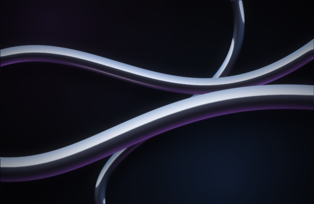<br><b><code>chrome</code></b><br><sub>Три хромированные трубки лежат друг на друге, фиолетовый контровой свет</sub></td><td width="33%" valign="top">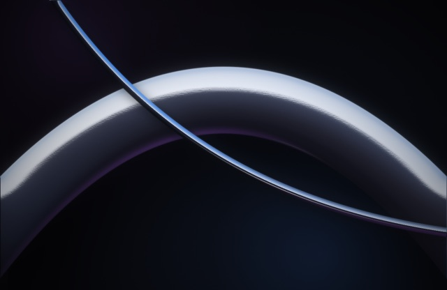<br><b><code>chrome-arc</code></b><br><sub>Одна толстая хромовая арка крупным планом, поперёк — тонкая трубка</sub></td><td width="33%" valign="top">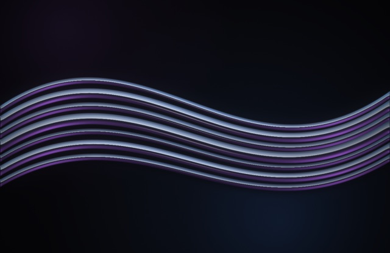<br><b><code>chrome-cables</code></b><br><sub>Пучок тонких хромовых кабелей течёт волной</sub></td></tr>
</table>

## Атмосфера

Атмосферные сцены, похожие на фото: туман, сумерки, снег. Нарисованы кодом в разрешении экрана, с глубиной резкости и плёночным зерном.
Превью — в тот час, который этой сцене идёт больше всего. `backdrop <имя>` ставит тёмную, читаемую версию за текст терминала.

<table>
<tr><td width="33%" valign="top">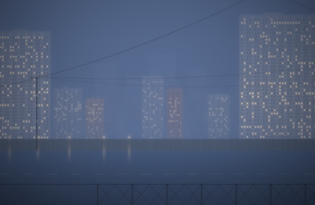<br><b><code>mistcity</code></b><br><sub>Панельки тонут в синем тумане: провода, забор и тёплые окна, которые ночью загораются этаж за этажом</sub></td><td width="33%" valign="top">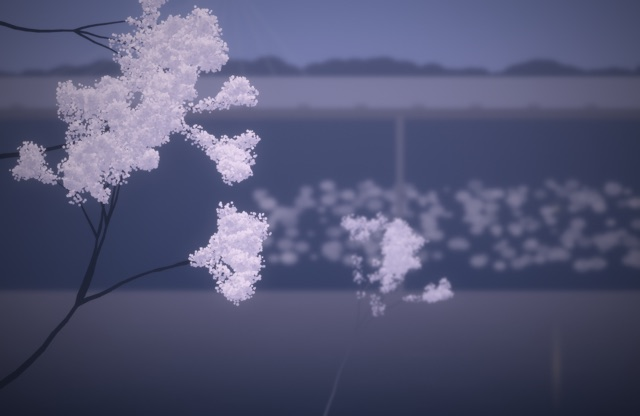<br><b><code>hanami</code></b><br><sub>Сакура в сумерках над мостом и тёмной водой; ночью загорается фонарь</sub></td><td width="33%" valign="top">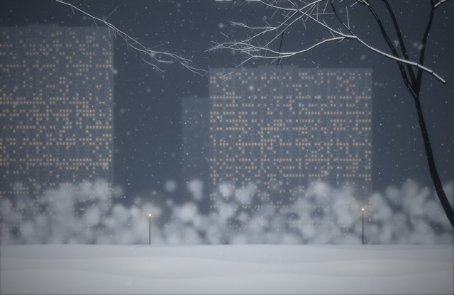<br><b><code>snowfall</code></b><br><sub>Двор в метель: высотки в дымке, ветки в снегу, хлопья на трёх глубинах</sub></td></tr>
<tr><td width="33%" valign="top">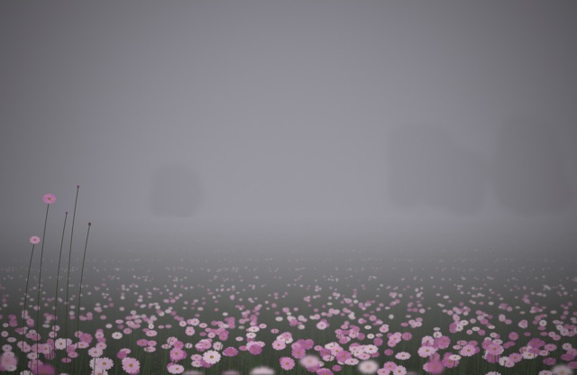<br><b><code>cosmea</code></b><br><sub>Поле розовой космеи уходит в густой туман, в фокусе несколько высоких стеблей</sub></td><td width="33%" valign="top">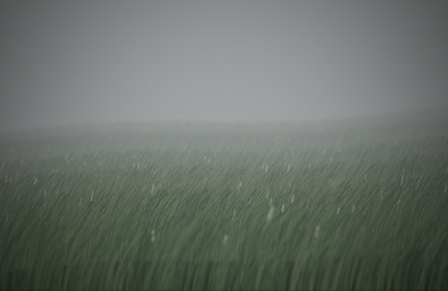<br><b><code>steppe</code></b><br><sub>Высокая трава под ветром, холм растворяется в дымке</sub></td></tr>
</table>

## Космос

<table>
<tr><td width="33%" valign="top">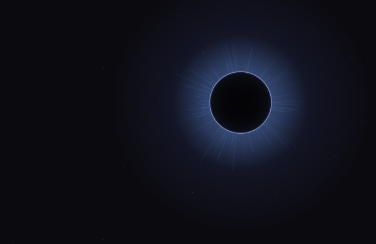<br><b><code>eclipse</code></b><br><sub>Чёрное солнце со светящейся короной; на рассвете и закате вспыхивает «бриллиантовое кольцо»</sub></td><td width="33%" valign="top">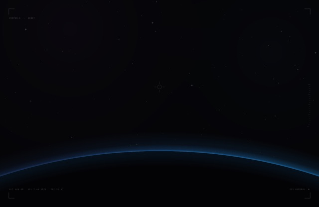<br><b><code>orbit</code></b><br><sub>Вид из кабины: край планеты, светящаяся атмосфера, восход на орбите, еле видный HUD</sub></td><td width="33%" valign="top">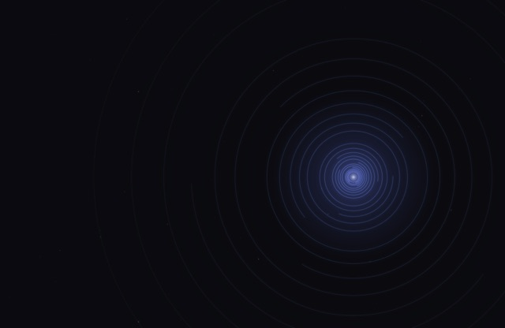<br><b><code>rings</code></b><br><sub>Тонкие кольца, как радар; дуги поворачиваются в течение дня</sub></td></tr>
<tr><td width="33%" valign="top">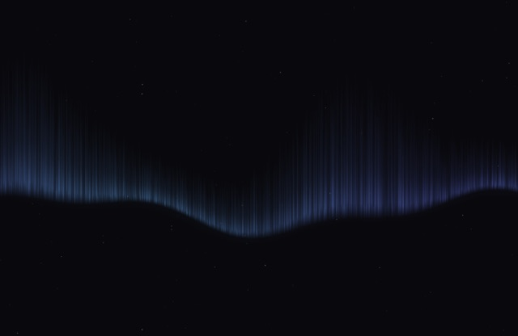<br><b><code>aurora</code></b><br><sub>Северное сияние в ночном небе, ночью ярче</sub></td><td width="33%" valign="top">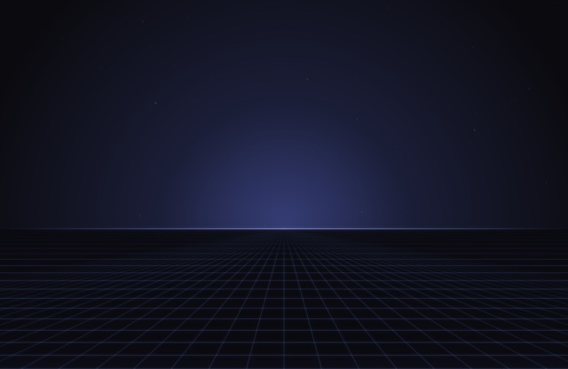<br><b><code>horizon</code></b><br><sub>Сетка-пол уходит к светящемуся горизонту</sub></td><td width="33%" valign="top">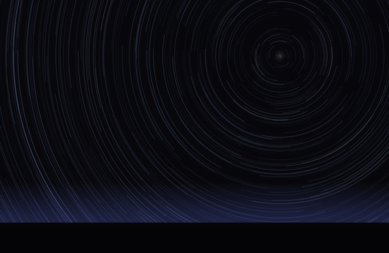<br><b><code>startrails</code></b><br><sub>Звёздные треки на длинной выдержке вокруг полюса, ночью длиннее</sub></td></tr>
</table>

## Техно

<table>
<tr><td width="33%" valign="top">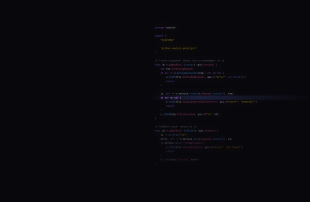<br><b><code>code</code></b><br><sub>Приглушённый код на Go/Gin с подсветкой и светящейся строкой курсора, которая за день спускается вниз</sub></td><td width="33%" valign="top">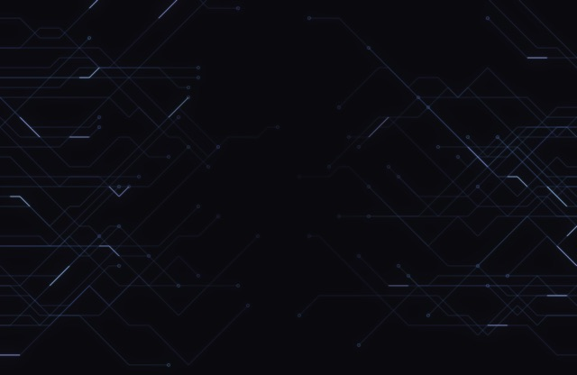<br><b><code>circuit</code></b><br><sub>Дорожки печатной платы, по которым бегут импульсы света</sub></td><td width="33%" valign="top">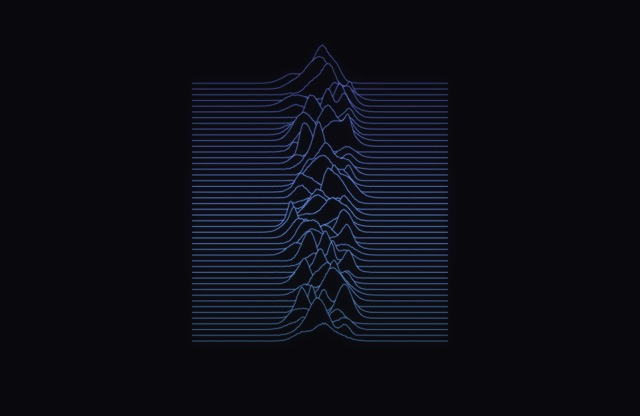<br><b><code>ridges</code></b><br><sub>Стопка линий-пиков в стиле Unknown Pleasures</sub></td></tr>
<tr><td width="33%" valign="top">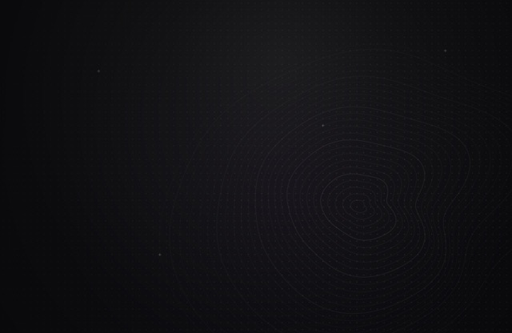<br><b><code>minimal</code></b><br><sub>Сетка точек, топографические линии и один мягкий свет</sub></td><td width="33%" valign="top">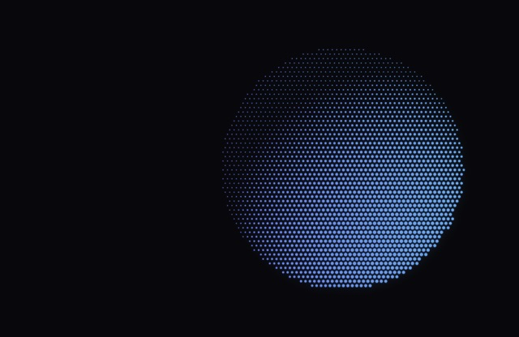<br><b><code>halftone</code></b><br><sub>Сфера из точек; свет обходит её за день</sub></td><td width="33%" valign="top">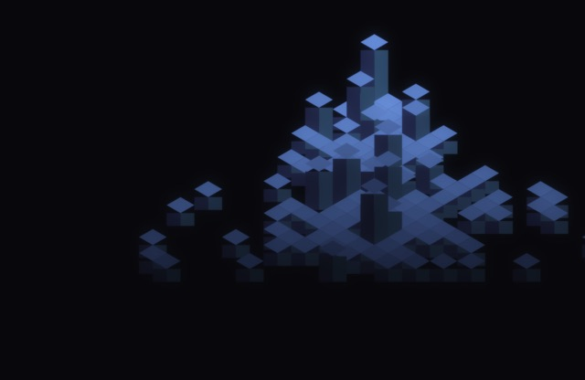<br><b><code>iso</code></b><br><sub>Изометрический город из светящихся кубов</sub></td></tr>
<tr><td width="33%" valign="top">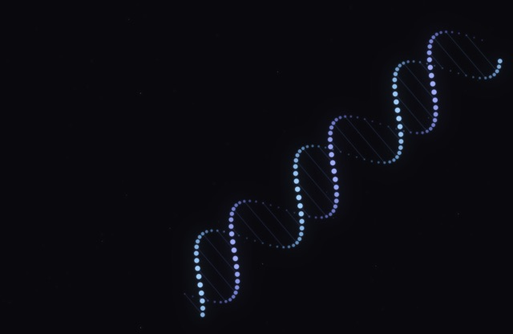<br><b><code>helix</code></b><br><sub>Двойная спираль ДНК из светящихся точек, поворачивается за день</sub></td><td width="33%" valign="top">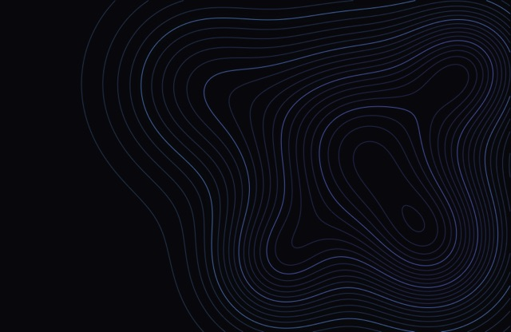<br><b><code>topo</code></b><br><sub>Топографическая карта, изолинии окрашены по высоте</sub></td></tr>
</table>

## Остальное

<table>
<tr><td width="33%" valign="top">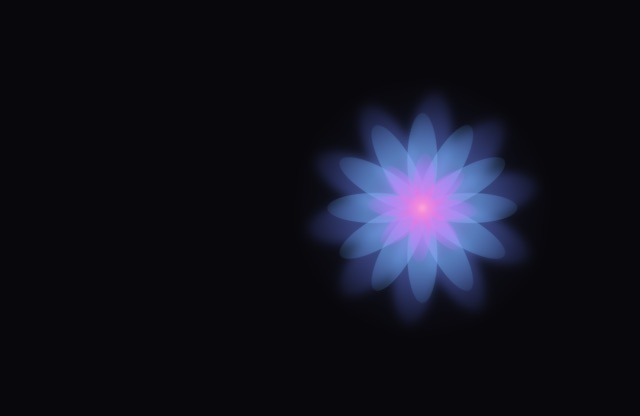<br><b><code>petals</code></b><br><sub>Абстрактный цветок из полупрозрачных лепестков, медленно вращается</sub></td><td width="33%" valign="top">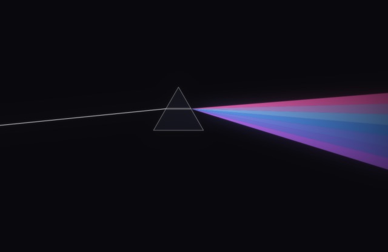<br><b><code>prism</code></b><br><sub>Луч входит в призму и раскладывается в фиолетово-синий спектр</sub></td><td width="33%" valign="top">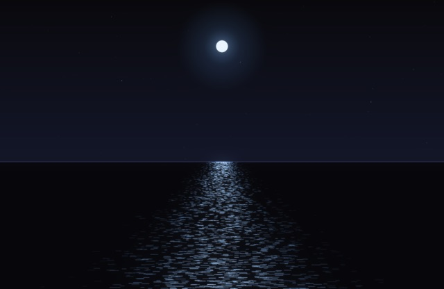<br><b><code>ocean</code></b><br><sub>Ночное море с лунной дорожкой; луна за день проходит по небу</sub></td></tr>
<tr><td width="33%" valign="top">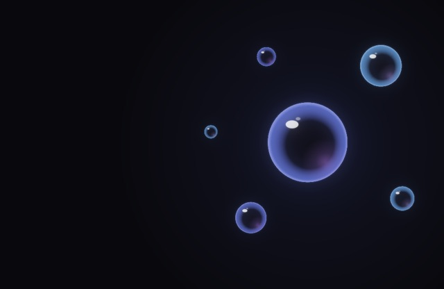<br><b><code>glass</code></b><br><sub>Стеклянные шары с цветными краями и бликами, медленно плывут</sub></td><td width="33%" valign="top">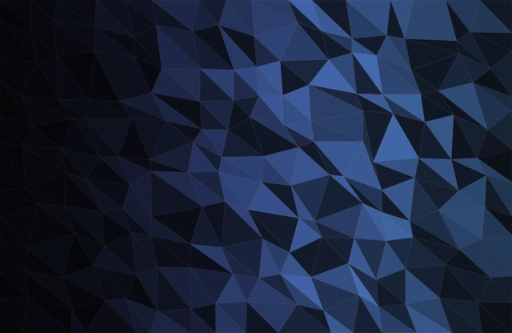<br><b><code>crystal</code></b><br><sub>Низкополигональные грани, освещённые как огранённый кристалл</sub></td><td width="33%" valign="top">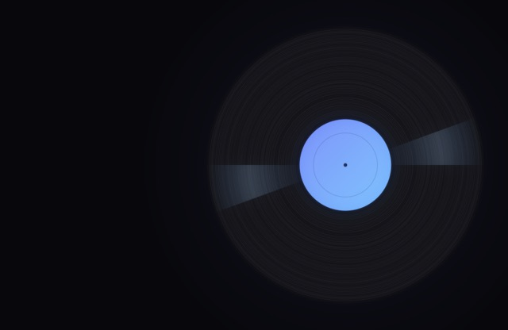<br><b><code>vinyl</code></b><br><sub>Виниловая пластинка с дорожками и градиентной наклейкой; поворачивается за день</sub></td></tr>
<tr><td width="33%" valign="top">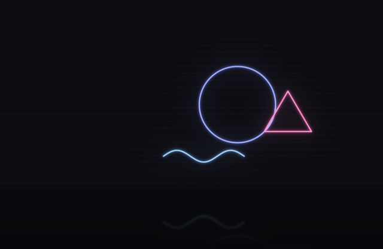<br><b><code>neon</code></b><br><sub>Неоновые фигуры на тёмной стене с отражением на полу</sub></td><td width="33%" valign="top">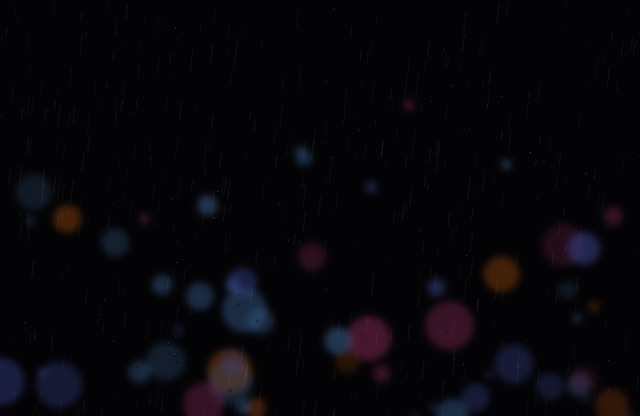<br><b><code>rain</code></b><br><sub>Ночной город сквозь мокрое стекло: боке огней, капли и потёки</sub></td><td width="33%" valign="top">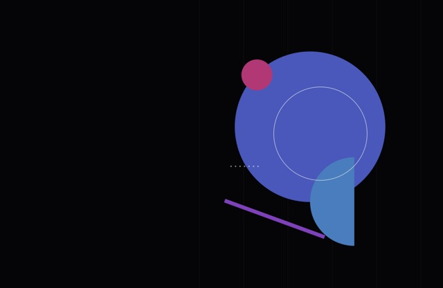<br><b><code>bauhaus</code></b><br><sub>Геометрический плакат: круги, полукруги, полосы</sub></td></tr>
<tr><td width="33%" valign="top">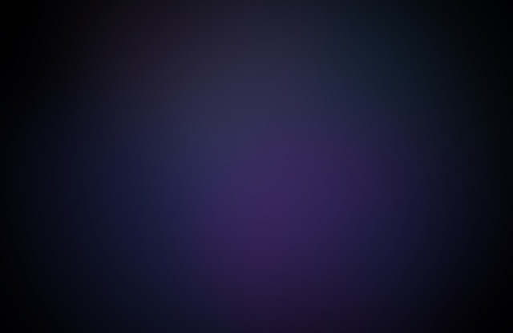<br><b><code>mesh</code></b><br><sub>Большие размытые цветные пятна, плывут в течение дня</sub></td><td width="33%" valign="top">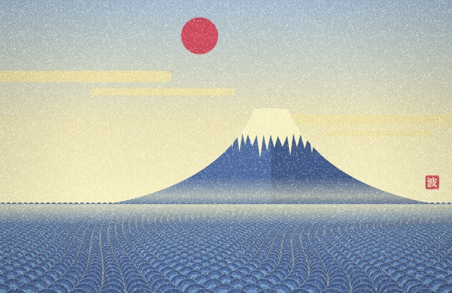<br><b><code>kanagawa</code></b><br><sub>Фудзи, море сэйгайха и туман касуми, по мотивам Хокусая</sub></td></tr>
</table>

## Свои обои

```swift
// icons/wallpaper-<name>.swift
runWallpaper { hour in
    let ctx = canvas()                     // почти чёрный холст
    let (a, b) = tint(hour)                // цвета для этого часа
    radialGlow(ctx, CGPoint(x: W / 2, y: H / 2), 400 * S, a, 0.3)
    return bloom(ctx.makeImage()!)
}
```

Общие детали — палитра, `tint(hour)`, `daylight(hour)`, звёзды, свечение, bloom и сборщик HEIC — лежат в
[`icons/wallpaper-kit.swift`](../icons/wallpaper-kit.swift). Потом `wall <имя>` соберёт и поставит.
