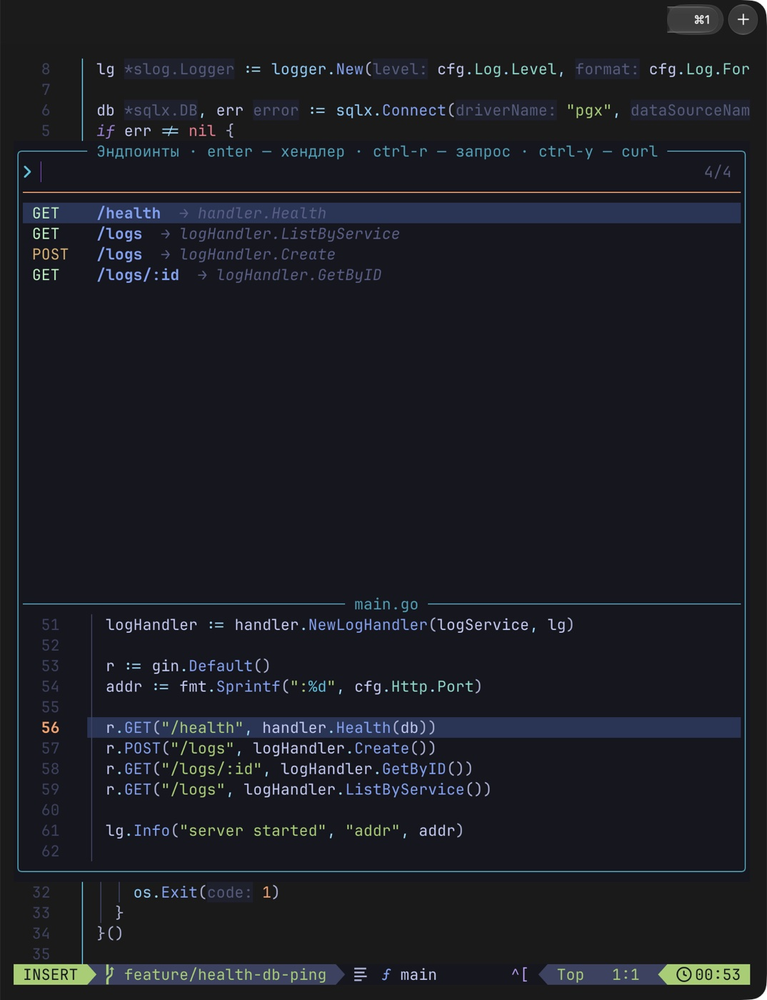

# nvim

🇷🇺 [Русская версия](README.ru.md) · [← dotfiles](../README.md)

Neovim on [LazyVim](https://lazyvim.org) — the escape hatch if Rune or Zed get old: a ready IDE in the terminal,
nothing to assemble by hand. A from-scratch config can later live in a sibling folder and run as
`NVIM_APPNAME=<name> nvim` without breaking this one.



<sub><code>space r e</code> — every route of the project, enter — to the handler, ctrl-r — a request.</sub>

| File | What |
|---|---|
| `init.lua` | one line: loads `lua/config/lazy.lua` |
| `lua/config/lazy.lua` | installs the lazy.nvim plugin manager and LazyVim; **background update checks are off** — update with `:Lazy update` |
| `lua/config/options.lua` | **the Russian layout understands vim commands** (`langmap`), 8 lines of context around the cursor |
| `lua/config/keymaps.lua` | debug F-keys like in Rune and GoLand, the cheat sheet (`space h`), line blame |
| `lua/config/autocmds.lua` | **autosave** (and with it imports and formatting) and reloading files changed outside |
| `lua/plugins/tasks.lua` | the Zed tasks: `up`, air, tests, coverage, linter, compose, docker build, hadolint, trivy, govulncheck, `dot` |
| `lua/dotfiles/http.lua` | **Postman in a file**: `.http` requests via curl, no plugins or licenses |
| `lua/dotfiles/endpoints.lua` | Gin endpoints, like the Endpoints window in GoLand (`space r e`) |
| `lua/plugins/dotfiles.lua` | **look**: tokyonight night (transparent) plus 6 more themes to pick (`alt-s` — with a preview, remembered), a "bubbles" status line, the start screen, borders |
| `lua/dotfiles/review.lua` | **Claude branch review** (`space a R`): `claude -p` over the diff against main, findings as diagnostics on lines and in quickfix |
| `lua/dotfiles/autotest.lua` | **background tests** after a save: `✓ 42` / `✗ 1` in the status line, the failed check as an error on its line |
| `lua/dotfiles/shot.lua` | **code screenshot** (`space P`) through freeze — a PNG to the clipboard and `~/Pictures/code` |
| `lua/dotfiles/tips.lua` | tip of the day on the start screen, taken from the cheat sheet |
| `lua/dotfiles/themes.lua` | **theme switcher on `alt-s`**: preview on the whole editor, `enter` remembers it (`~/.local/state/nvim/colorscheme`) |
| `lua/dotfiles/theme.lua` | rose-pine **in the dotfiles theme colors** (the `themes/<theme>.sh` palette, Dev Day when light); colors for ▶, "implements" and multiple cursors in any theme |
| `lua/plugins/goland.lua` | **Go like GoLand**: actions with a preview, refactorings, "implements", generation (`space G`), peek, coverage, call hierarchy, dlv in Docker |
| `lua/dotfiles/run.lua` | ▶ next to `func main` and tests — `space r x` runs, `space r X` debugs |
| `lua/plugins/ui.lua` | breadcrumbs, errors right of the line (Error Lens), multiple cursors |
| `lua/plugins/git.lua` | diffview (three-way merge, history, branch against main), blame, edit history (undotree) |
| `lua/plugins/ai.lua` | Claude Code in nvim, Kubernetes (kubectl.nvim) |
| `lua/plugins/learn.lua` | learn as you go: motion marks in the line (precognition), a habit coach in hint mode (hardtime) |
| `lua/plugins/tools.lua` | Claude on `alt-c` and "fix it" (`space a x`), gw on `alt-w`, yazi, Go scratch, structural replace (ast-grep), quicker, persistent breakpoints |
| `lua/plugins/editing.lua` | `ctrl-a` for Go (`:=`↔`=`, `t.Error`↔`t.Fatal`, HTTP methods and statuses), `.env` under asterisks |
| `queries/go/injections.scm` | SQL inside Go strings is highlighted as SQL |
| `snippets/go.json` | own Go snippets: `ife`, `errw`, `tt`, `gh`, `bench`… |
| `lazyvim.json` | enabled extras: Go, Docker, YAML, JSON, Markdown, debugger, tests, sticky header, Structure, rename with a preview, Claude Code, surround, dial, yanky |
| `lazy-lock.json` | exact versions of every plugin — another Mac gets the same thing |

`install.sh` links `~/.config/nvim → nvim/`. The previous hand-written `init.lua` is kept as
`~/.config/nvim.bak-20261014`. Plugins and tools live outside the repo, in `~/.local/share/nvim`.

## First run

```bash
nvim .            # in a project folder
```

The first run fetches whatever is missing: highlighting parsers are built by `tree-sitter-cli` (in the Brewfile),
language servers and tools come from Mason (`:Mason` — list, status, reinstall).
Already installed: gopls, delve, golangci-lint, gofumpt, goimports, servers for Lua, YAML, JSON, Dockerfile, compose, Markdown.

## Vim from zero: 20 commands for the first week

Vim is modes. **Normal** (`esc`) — move and command, **insert** (`i`) — type, **visual** (`v`, `V`) — select.
A command is action + motion: `d` (delete) + `w` (to the next word) = `dw`. A number in front repeats it: `3dd`.

| | Keys | What |
|---|---|---|
| move | `h j k l` · `w` / `b` · `0` / `$` · `gg` / `G` | ←↓↑→ · word forward / back · line start / end · file start / end |
| | `{` / `}` · `ctrl-d` / `ctrl-u` · `s` + 2 letters | paragraph · half a screen · jump anywhere (flash) |
| type | `i` / `a` · `o` / `O` · `esc` | before / after the cursor · new line below / above · leave |
| change | `x` · `dd` · `dw` · `cw` · `ciw` · `ci"` | char · line · word · change word · the whole word under the cursor · text inside quotes |
| | `yy` · `p` · `u` · `ctrl-r` · `.` | copy line · paste · undo · redo · **repeat the last change** |
| search | `/text` → `n` / `N` · `*` | find, next / previous · the word under the cursor |
| files | `:w` · `:q` · `space f f` · `space e` | save (not needed — autosave) · quit · find a file · tree |

Practice: `:Tutor` — a built-in 30-minute lesson. Live on this table for a week and your fingers take over.

## One key press

| Keys | What |
|---|---|
| `alt-o` | **orbstack** — containers in a float; `alt-o` again closes it |
| `alt-g` | **lazygit** |
| `alt-p` | **Postman** — the project's `api.http` ([how to](../docs/postman.md)) |
| `alt-a` | **API endpoints** — every route, enter jumps to the handler |
| `alt-d` | **database**; `alt-d` again closes it |
| `alt-t` | **tasks** (`up`, tests, linter, compose…) |

They work in the Russian layout too. These are the `alt` letters AeroSpace leaves free.

## The key is space

`space` (leader) opens a menu of every action with hints, so there is nothing to memorise.

| Keys | What |
|---|---|
| `space f f` · `space /` · `space ,` | file by name · text across the project · open buffers |
| `space e` | file tree |
| `gd` · `gr` · `gI` · `K` | definition · usages · implementations · docs |
| `space c r` · `space c a` | rename · code actions (fixes, gopls refactorings) |
| `space x x` | every problem in a list (Trouble) |
| `space t r` · `space t t` · `space t s` | test at cursor · tests in the file · test panel |
| `space d b` · `space d c` · `space d O` / `d i` / `d o` · `space d t` | breakpoint · run/continue · step / into / out · stop |
| `space g g` · `space r d` | lazygit · lazydocker |
| `space r e` | **Gin endpoints** with full paths (`Group` prefixes added up): `enter` — to the handler, `ctrl-r` — **send the request** (response on the right, the login token is reused, `q` closes), `ctrl-y` — copy a `curl` |
| `space r r` · `space r l` | tasks like `ctrl-r` in Zed · what ran and how it ended |
| `V` … `J` / `K` | move selected lines down / up (AeroSpace owns `alt-j/k`) |
| `space s k` | search all keymaps |
| `space D` | **the project database**: tables, queries, results as a table (address like `db`: from `.env` or the folder name) |
| `space r c` | **containers** — `orbstack` in a floating window |
| `space r p` · `space r w` · `space r b` | `dot project doctor` · `dot work` · `dot backup` |
| `space g b` | **line history**: who changed it and when, `enter` — the whole commit |
| `space g p` · `space g i` | GitHub **pull requests and issues** (via `gh`): diff, comments on lines, review |

Dockerfiles are checked by hadolint as you type — findings show up like normal errors. The status line shows `◆ mode 1h12m` while `dot work` is on.

## Stronger than GoLand

Everything that was missing compared to GoLand, and a bit more — **[the cheat sheet: GoLand → nvim key by key](../docs/nvim.md)** (`space h` in nvim).

- **▶ next to `func main` and tests** — `space r x` runs the function at the cursor, `space r X` debugs it.
- **`реализует: io.Reader`** in grey next to a type and `реализуют: …` next to an interface — like the ↑↓ icons.
- **Actions with a preview** (`space c a`): every fix and refactoring shows its diff before it applies.
  Extract / inline / rewrite — `space c x` / `c i` / `c w`, call hierarchy — `space c h`.
- **Generation — `space G`:** tags, implement an interface, `if err`, tests, `go mod tidy`, line coverage.
- **Peek** — `gpd` / `gpr` / `gpi`: definition, usages, implementations in a popup.
- **Breadcrumbs, a sticky function header, the Structure window, errors as a badge on the right** (like Error Lens).
- **Git:** three-way merge conflicts, file history, the branch against main (`space g v` / `g H` / `g m`), line blame, Local History.
- **Beyond GoLand:** Claude Code in a panel with diff edits (`space a c`), multiple cursors (`ctrl-n`), Kubernetes (`space k`), dlv debugging in Docker.
- **Claude review** (`space a R`): findings on the branch diff land on code lines like linter errors.
- **Themes:** tokyonight by default, `alt-s` for kanagawa, carbonfox, cyberdream, vesper, gruvbox-material and rose-pine in the terminal colors.

## By itself, no `:w`

- **Autosave:** leave insert mode, change something in normal mode, move to another window — the file is written.
- **Imports fix themselves** on every write: goimports adds what's needed (stdlib and `go.mod` deps like gin)
  and drops what isn't, gofumpt formats. Completing a package name adds its import right away.
- **Outside changes come in by themselves:** Claude Code, `git pull`, `go generate` — the buffer reloads after a typing pause.
- Pause autosave: `:let g:autosave = v:false`.
- **Neovim is the default editor** (`$EDITOR`): `git commit`, `e` in lazygit (right at the line), yazi, `crontab -e`.

## Postman in a file

**A 5-step guide in plain words: [docs/postman.md](../docs/postman.md).** Below is for when you already know it.

`space r h` builds `api.http` in the project root: every Gin route as a request, login first. From then on the file is
yours — edit bodies and params. Cursor on a request → `enter` — the response on the right (JSON, status, time), `q` closes.

```http
@host = http://localhost:8080

### POST /auth/login
# @name login
POST {{host}}/auth/login
Content-Type: application/json

{"email": "me@example.com", "password": "secret"}

### GET /api/me — the token from the login response fills in
GET {{host}}/api/me
Authorization: Bearer {{login.response.body.$.access_token}}
```

`space R r` — replay the last one, `space R c` — copy as curl, `space R n` / `R p` — next / previous request.
Works with any `.http` file from VS Code or GoLand. LazyVim's kulala isn't used: since 2026 it needs a paid license.

## Russian layout

No need to switch the language: in normal mode Russian letters act like the English ones on the same keys.
`о`/`л` — down/up (`j`/`k`), `вв` — delete the line (`dd`), `ц` — next word (`w`), `Ж` — command (`:`),
`Жц` + `enter` — save. In insert mode letters are typed as they are.

## Debugging like GoLand

| Keys | What |
|---|---|
| `F9` | run / continue |
| `F8` · `F7` · `shift-F8` | step · into · out |
| `ctrl-F8` | breakpoint |

F-keys need `fn` on a Mac. All of it is also on `space d …`.

## Change it

- **A language or feature:** `:LazyExtras` — toggle with one key (written to `lazyvim.json`, commit it).
- **A plugin or plugin settings:** a new file in `lua/plugins/` — LazyVim picks it up.
- **Own keys and options:** `lua/config/keymaps.lua` and `options.lua`.
- **Update plugins:** `:Lazy update`, then commit `lazy-lock.json`.
